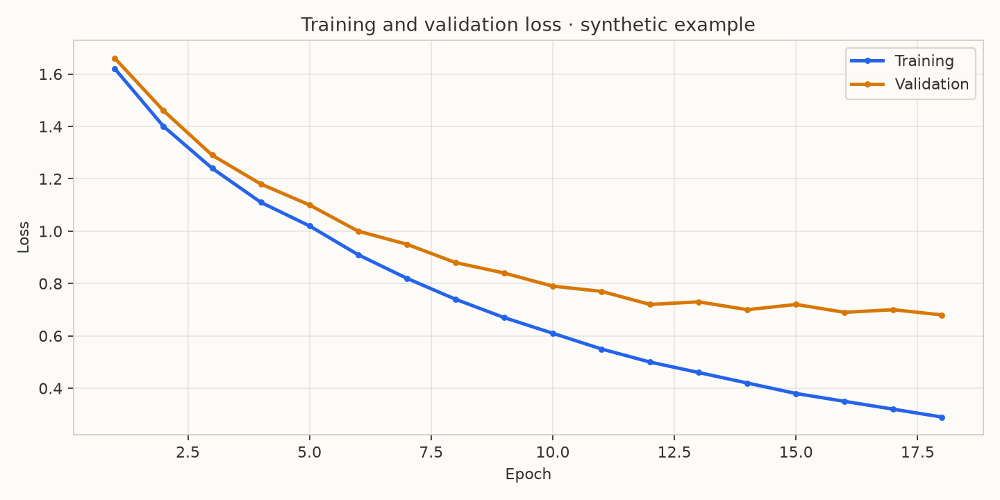
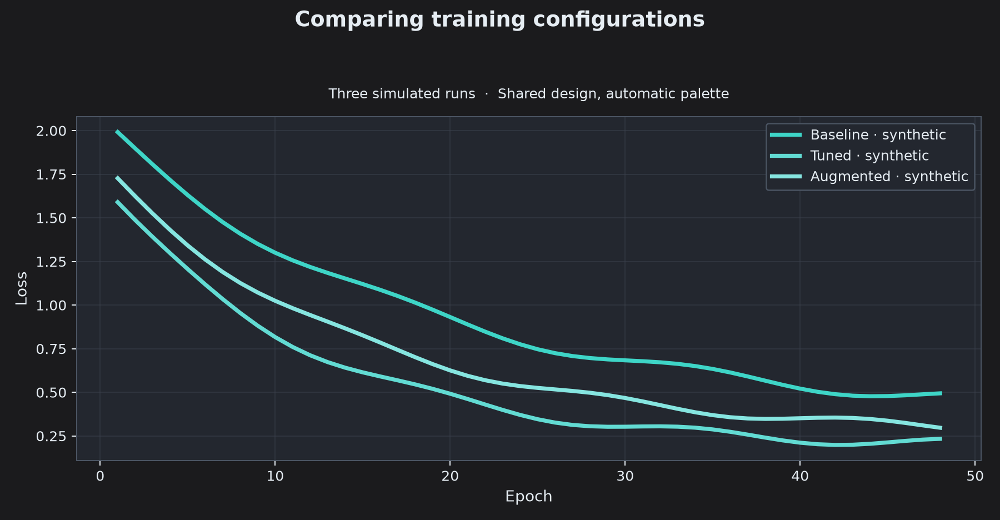

# Lispyn

**Write complex experiments. Make them easy to understand, reuse, and share.**

Great experiments deserve to be understood—not just executed. Whether you're exploring new AI models, fine-tuning neural networks, or running advanced training pipelines, you often need to **show others what you built, how it works, and what you learned**.

**Lispyn** uses Lisp-based [Hy](https://hylang.org/) macros to turn repetitive steps into **concise, reusable building blocks**. Prepare datasets, train with PyTorch, document your choices in Markdown, and generate plots—all from a readable Lisp source that becomes a standard **Python Jupyter notebook**.

Spend less time rewriting boilerplate and more time experimenting. When your dataset, model, or training strategy changes, adapt the macro and reuse the workflow. **Lisp for expressive experiments. Python for the ecosystem. Jupyter for sharing results.**

**Installation:** for development, clone the repository and use
`python -m pip install -e ".[dev,notebook,plots]"`. For users, we are
preparing a PyPI release; `pip install lispyn` is intended **after publication**,
not a claim that a package is already available there. Check your local setup
with `lispyn doctor` (or `lispyn doctor --json`). See
[release instructions](https://github.com/edujbarrios/lispyn/blob/main/docs/releasing.md).

## Matplotlib with reusable Lisp macros

Define a design once and apply it to any recorded history. This short example
uses a dark gray background inspired by Docusaurus and the seven-color
**turquoise-spectrum** palette:

```hy
(require lispyn.macros [defcurve compare-curves])
(setv history {"train_loss" [1.5 1.1 0.8 0.55]
               "val_loss" [1.6 1.2 0.95 0.76]})
(defcurve turquoise-dark
  :theme "docusaurus-dark"
  :palette "turquoise-spectrum"
  :train-color "#40E0D0" :val-color "#8CF0EB"
  :title-size 18 :line-width 2.8 :fill-alpha 0.08)
(turquoise-dark history
  :metric "loss" :title "Training dynamics"
  :subtitle "Synthetic example · 4 epochs"
  :save "training.png")
```

**Generated from Lispyn + Matplotlib using synthetic values, not a trained model.**



The same Lisp file can compare several named runs, automatically assigning
distinct colors from the palette:



Full reproducible source: [synthetic_curves.hy](https://github.com/edujbarrios/lispyn/blob/main/examples/synthetic_curves.hy)
· [generated Jupyter notebook](https://github.com/edujbarrios/lispyn/blob/main/example_generated_notebooks/synthetic_curves.ipynb).
Regenerate the figures with `lispyn run examples/synthetic_curves.hy`.

Classification reports are equally concise: the new `defconfusion` macro
creates a reusable dark-themed confusion matrix from actual and predicted labels.
See the [Lisp example](https://github.com/edujbarrios/lispyn/blob/main/examples/confusion_matrix.hy)
and its [generated figure](https://github.com/edujbarrios/lispyn/blob/main/docs/images/synthetic_confusion_matrix.png).
The example uses **synthetic class labels**, not real model predictions.

## Full experiment — ResNet18, two-stage fine-tuning

The following is the complete source of [`examples/resnet_finetune_300.hy`](https://github.com/edujbarrios/lispyn/blob/main/examples/resnet_finetune_300.hy), including its Markdown cells. Put your images in `examples/data/resnet_images/<class_name>/*.jpg` (or `.png`); each class needs multiple images. The first stage trains the classifier for **10 epochs**, then the second unfreezes all layers for **300 epochs**.

```clojure
; ResNet18 experiment: all results are Python/Jupyter notebook cells.
; Required actual images: examples/data/resnet_images/class_name/*.jpg or *.png
; This source is NOT executed in CI (300 epochs need a real dataset/GPU).
(require lispyn.macros [md])

(md "# ResNet18 — transfer learning + full fine-tuning"
    "An end-to-end **PyTorch** experiment written in Lispyn. It loads labeled images, splits by class, runs head-only tuning, then unfreezes the backbone for **300 epochs**, and produces publication-ready curves."
    "**Author:** Eduardo J. Barrios · **Source:** Lispyn.")

(md "## Install required libraries"
    "The **pip-install** macro generates a dedicated Python notebook setup cell. Already available packages report *Requirement already installed in this environment*; only missing packages are installed in the current kernel."
    "Python standard-library modules such as `math` need no installation. For CUDA/accelerator setups, install matching PyTorch/TorchVision builds beforehand. Installing native packages may require a kernel restart.")

(require lispyn.macros [pip-install])
(pip-install "torch" "torchvision" "matplotlib>=3.8")

(require lispyn.macros [use-package])
(setv math (use-package "math" :install False))
(print "math.sqrt(16):" (math.sqrt 16))

(md "## Load and split the image dataset"
    "Use the original TorchVision preprocessing for the pretrained ResNet18 weights. Classes come from your own image folders; samples are split reproducibly into training and validation.")
(import torch)
(import torchvision)
(import lispyn.media [image-folder])
(import lispyn.data [split-dataset])
(import lispyn.reproducibility [seed-all])

(seed-all 42)
(setv weights torchvision.models.ResNet18_Weights.DEFAULT)
(setv dataset (image-folder "data/resnet_images" :transform (weights.transforms)))
(setv groups (split-dataset dataset :stratify True :validation-fraction 0.2 :seed 42))
(setv training (get groups 0))
(setv validation (get groups 1))
(setv model (torchvision.models.resnet18 :weights weights))
(setv model.fc (torch.nn.Linear model.fc.in_features (len dataset.classes)))
(print "Classes:" dataset.classes)
(print "Train/validation:" (len training) (len validation))

(md "## Phase 1 — classifier fine-tuning"
    "Freeze the pretrained ResNet18 backbone and optimize only `model.fc` for **10 epochs**. The class split is reproducible and separate from the training set."
    "**Note:** This example needs at least two labeled images per class. For correlated images from the same subject, use a *group-aware split* instead.")

(require lispyn.macros [head-tune])
(setv head-run
  (head-tune model training "fc"
    :validation validation
    :loss-fn (torch.nn.CrossEntropyLoss)
    :epochs 10
    :batch-size 16
    :lr 0.001
    :seed 42
    :metrics "accuracy"
    :experiment-dir "runs/resnet/head"))
(print "Head validation accuracy:" (get head-run.history "val_accuracy"))

(md "## Phase 2 — deep/full fine-tuning: 300 epochs"
    "Unfreeze **every ResNet18 layer**, create a new optimizer with a smaller learning rate, and train for **300 epochs**. This is full fine-tuning of pretrained weights, **not** training from scratch."
    "A real 300-epoch run may take hours and require a GPU. Run it only with your own dataset and appropriate resources.")

(require lispyn.macros [full-tune])
(setv deep-run
  (full-tune head-run.model training
    :validation validation
    :loss-fn (torch.nn.CrossEntropyLoss)
    :epochs 300
    :batch-size 16
    :lr 0.00001
    :seed 42
    :metrics "accuracy"
    :experiment-dir "runs/resnet/deep"))
(print "Full tuning best accuracy:" (max (get deep-run.history "val_accuracy")))

(md "## Curves and export"
    "Use one Lisp macro to define a consistent Matplotlib style for **both** training curves. The best checkpoints and JSON histories are saved under `runs/resnet/`.")

(require lispyn.macros [defcurve])
(defcurve resnet-curve
  :theme "paper"
  :train-color "#2563EB"
  :val-color "#D97706"
  :xlabel "Epoch"
  :train-label "Train"
  :val-label "Validation"
  :figsize [9 4])

(resnet-curve deep-run :metric "loss"
  :title "ResNet18 — 300-epoch loss"
  :ylabel "Cross-entropy loss"
  :save "runs/resnet/deep/loss.png")

(resnet-curve deep-run :metric "accuracy"
  :title "ResNet18 — 300-epoch accuracy"
  :ylabel "Top-1 accuracy"
  :save "runs/resnet/deep/accuracy.png")
(print "Saved ResNet18 plots, histories, and best checkpoints.")
```

## Generated notebook

**[Open the generated ResNet18 notebook](https://github.com/edujbarrios/lispyn/blob/main/example_generated_notebooks/resnet_finetune_300.ipynb)** in [`example_generated_notebooks/`](https://github.com/edujbarrios/lispyn/tree/main/example_generated_notebooks/). It contains real Markdown and translated Python code cells, but **no simulated losses or training outputs**. Use `lispyn gallery` to regenerate the examples without running training.

To install Lispyn from this repository, use `python -m pip install -e ".[notebook,plots]"`. Run `lispyn build examples/resnet_finetune_300.hy` to regenerate the notebook, or `lispyn execute examples/resnet_finetune_300.hy -o example_generated_notebooks/resnet_finetune_300.ipynb` to **actually train** and save the outputs.

The `pip-install` macro creates a dedicated dependency cell that checks availability when the notebook **runs**, not when it compiles. Available packages print *Requirement already installed in this environment*. Missing named packages can be installed through the notebook kernel’s Python interpreter. Python's standard-library `math` module requires no pip install. GPU-compatible PyTorch builds should normally be installed separately in advance; installing packages into a running kernel may require a restart.

**This experiment has not been trained for 300 epochs in CI.** It needs an image dataset and may require substantial compute. Stratified sample-level splitting is not group-aware; use a grouped split when images come from the same subjects, patients or sessions.

More capabilities, examples and package options are in the [technical guide](https://github.com/edujbarrios/lispyn/blob/main/docs/guide.md). Created by **Eduardo J. Barrios**. Apache-2.0 licensed; see [LICENSE](https://github.com/edujbarrios/lispyn/blob/main/LICENSE) and [NOTICE](https://github.com/edujbarrios/lispyn/blob/main/NOTICE).
