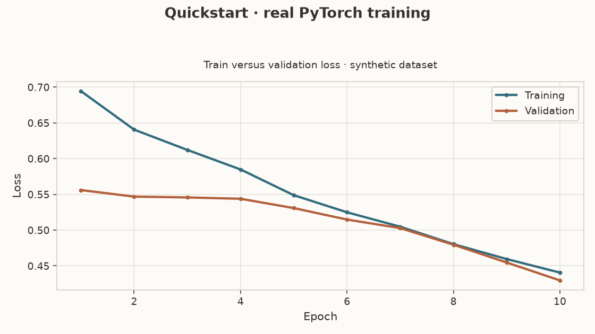

# Lispyn

**A new way to write and run machine-learning experiments.**

Write an experiment once in **Hy (Lisp for Python)**, train with native **PyTorch**, and get a real, shareable **Jupyter notebook** with code, metrics and plots. Lispyn adds expressive macros to your existing Python workflow; it does not replace PyTorch.

[](https://pypi.org/project/lispyn/) [](https://github.com/edujbarrios/lispyn/actions/workflows/tests.yml) [](LICENSE)

## Install

```bash
pip install lispyn
```

**Jupyter and Matplotlib are included.** PyTorch is installed separately to match your CPU/GPU setup ([official instructions](https://pytorch.org/get-started/locally/)). From a source checkout, `pip install -r requirements.txt` provides an optional full research environment.

## See Lispyn in action

<!-- QUICKSTART_EXECUTED:START -->
**Hy syntax** — an excerpt from the [full runnable experiment](examples/quickstart.hy) (native PyTorch; tiny synthetic dataset):

```hy
(require lispyn.macros [train-until])
(setv model (torch.nn.Linear 2 2))
(setv run
  (train-until model training 3
    :validation validation :loss-fn (torch.nn.CrossEntropyLoss)
    :epochs epochs :batch-size 4 :lr 0.05 :seed seed :device "cpu"))
(print "Completed epochs:" (len (get run.history "train_loss")))

(require lispyn.macros [curve])
(curve run :metric "loss" :theme "paper"
  :title "Quickstart · real PyTorch training"
  :subtitle "Train versus validation loss · synthetic dataset"
  :figsize [8 4.5]
  :save "../example_generated_notebooks/assets/quickstart_training_curves.png")
```

**Real recorded output:**

`Samples: 8 train, 4 validation, 4 held-out test` · `Completed epochs: 10`

Held-out test accuracy: **50.0%**



[View every executed Jupyter cell](example_generated_notebooks/quickstart_executed.ipynb) · [Full Hy source](examples/quickstart.hy)

_Toy data for workflow demonstration only; not a scientific benchmark._
<!-- QUICKSTART_EXECUTED:END -->

Run it yourself:

```bash
lispyn execute examples/quickstart.hy
```

Lispyn builds and executes standard Python notebook cells. For compilation without training, use `lispyn build examples/quickstart.hy`.

## More than training

Use **45 documented Hy macros** for experiment parameters, PyTorch training, evaluation splits, cross-validation, comparisons, reports and figures. [Explore every macro and its syntax](supported_macros/README.md).

Need an additional library inside the notebook? Lispyn can create a dedicated dependency cell:

```hy
(require lispyn.macros [pip-install])
(pip-install "scikit-learn>=1.5")
```

The package is checked/installed **when the notebook is executed**, never when compiling it.

## Share and verify results

Package a **completed** experiment into a portable ZIP and verify its SHA-256 integrity without rerunning the notebook:

```bash
lispyn capsule examples/quickstart.hy example_generated_notebooks/quickstart_executed.ipynb -o study.zip
lispyn verify-capsule study.zip
```

You can include aggregate saved-run metrics with `--run RUN_DIR`. Capsules never automatically collect raw datasets or model weights; **review notebook outputs before sharing**. Checksums detect corruption, not authorship or scientific validity.

[Full Hy examples](examples/) · [Notebook gallery](example_generated_notebooks/) · [Macro reference](supported_macros/README.md) · [How to cite Lispyn](CITATION.cff)

*Created by Eduardo J. Barrios · [Apache-2.0](LICENSE) · Experimental alpha software.*
