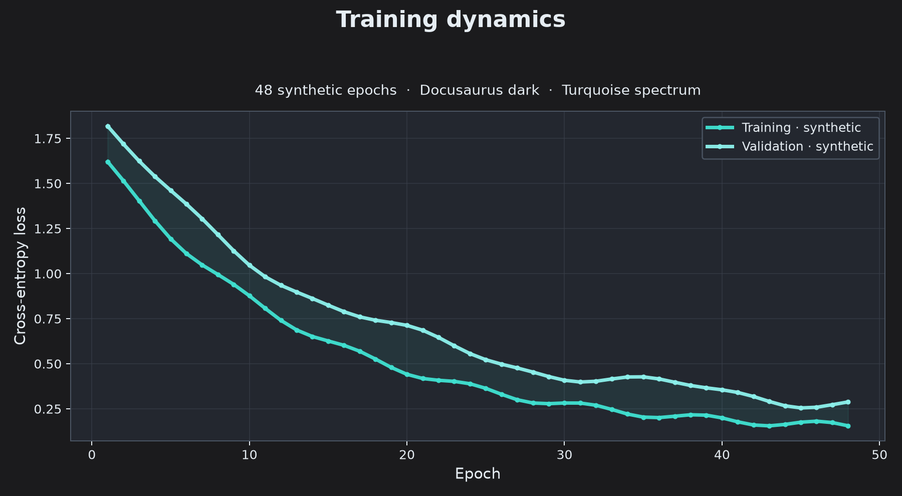

# Lispyn

**Design experiments in Lisp. Run native Python and PyTorch. Share the results in Jupyter.**

*Lisp for expressive experiments. Python for the ecosystem. Jupyter for sharing results.*

[](https://pypi.org/project/lispyn/)
[](https://github.com/edujbarrios/lispyn/actions/workflows/tests.yml)
[](https://pypi.org/project/lispyn/)
[](LICENSE)

**Lispyn is a Hy/Lisp macro toolkit for researchers who already use Python and PyTorch.** Express a repeatable training or evaluation experiment concisely in a `.hy` file; Lispyn compiles it into a **normal, inspectable Python Jupyter notebook** with narrative cells, metrics and reproducible parameters.

No new tensor framework. No new training runtime. **Your models, datasets, optimizers and plots remain native Python.**

**[Explore all 42 supported macros →](supported_macros/README.md)** · [Run the example](examples/quickstart.hy) · [Browse generated notebooks](example_generated_notebooks/) · [PyPI](https://pypi.org/project/lispyn/)

---

## Why would a researcher use this?

Researchers need more than a script that trains a model: they need to **iterate without losing context, compare variants, prevent leakage and show their work**.

| Common research friction | The Lispyn workflow |
| --- | --- |
| Notebooks mix exploratory code with one-off boilerplate | **Author in Hy**; compile reproducible, reviewable Python notebook cells |
| Experiment options are scattered through a script | Declare **`experiment-params`**; override them from the CLI or generate notebook variants |
| Training, early stopping and checkpoint wiring are repeated | Use compact **Hy macros** around standard PyTorch models and datasets |
| Random splits accidentally mix subjects or future observations | Use grouped, stratified or chronological **train/validation/test and CV macros** |
| Results live in console logs and screenshots | Generate Markdown summaries, figures, narrative cells and explicit evidence checks |
| Sharing a notebook does not prove it ran or matches its source | Use **`lispyn audit`** to inspect execution/errors and verify the original Hy source hash |

**The difference is in the workflow:** the experiment definition becomes the source of truth, while the resulting notebook remains a familiar artifact for collaborators, supervisors and reviewers.

**A glimpse of the output — publication-style figures from Hy macros**



*Illustrative training curves generated from **synthetic values** to demonstrate Lispyn's reusable plotting styles; these are **not results from a trained model**.*

## Install in two steps

Python **3.10+** is supported. A virtual environment is recommended.

```bash
python -m pip install --upgrade "lispyn[notebook,plots]"
python -m pip install torch
```

Install PyTorch using the [official instructions](https://pytorch.org/get-started/locally/) if you need a CUDA/ROCm or other platform-specific build. For pandas add `python -m pip install "lispyn[data]"`; vision/audio/LoRA dependencies are optional.

Check your installation:

```bash
lispyn --version
lispyn doctor
```

**Already have a PyTorch setup?** Lispyn can be installed into that environment; it does not replace your native PyTorch build.

## A real experiment, from Hy to Jupyter

This example fits a **real PyTorch classifier on tiny synthetic data**. It uses a separate held-out test subset, so the baseline's validation score is **not presented as a generalization claim**. No dataset download or GPU required.

Save as `study.hy`:

```hy
(require lispyn.macros [md])
(md "# A small classification study"
    "Real PyTorch training on toy data; reserve test rows for later.")

(require lispyn.macros [experiment-params])
(experiment-params
  (setv seed 42)
  (setv epochs 6))

(require lispyn.macros [train-val-test train-until report-run])
(import torch)

(torch.manual_seed seed)
(setv x (torch.tensor
  [[0.0 0.0] [0.0 1.0] [1.0 0.0] [1.0 1.0]
   [0.2 0.3] [0.3 0.9] [0.9 0.3] [0.8 0.9]]))
(setv y (torch.tensor [0 1 0 1 0 1 0 1]))
(setv data (torch.utils.data.TensorDataset x y))
(setv [training validation held-out]
  (train-val-test data :validation-fraction 0.25
    :test-fraction 0.25 :seed seed))

(setv result (train-until (torch.nn.Linear 2 2) training 2
  :validation validation
  :loss-fn (torch.nn.CrossEntropyLoss)
  :epochs epochs :batch-size 2 :lr 0.05 :seed seed :device "cpu"))

(report-run result :title "Synthetic baseline")
(print "Reserved test examples:" (len held-out))
```

Now use **one Hy source** for different outcomes:

```bash
# Compile only: inspect or edit the ordinary Python/Jupyter notebook
lispyn build study.hy

# Execute in a Jupyter kernel, saving actual outputs to study.ipynb
lispyn execute study.hy

# Audit stored execution status and match the notebook to the original Hy file
lispyn audit study.ipynb --source study.hy

# Share a portable Markdown summary of the executed notebook
lispyn export study.ipynb -o study_report.md

# Change experimental parameters without editing study.hy
lispyn build study.hy --set epochs=12 -o study_12_epochs.ipynb
```

**What does the recipient see?** A standard `.ipynb` with your explanation, compiled Python training code and *real* outputs, followed by a Markdown experiment report. `lispyn build` alone **does not train**; `lispyn execute` does. The project also includes the same example as a ready-to-run file: [`examples/quickstart.hy`](examples/quickstart.hy).

<details>
<summary><strong>What's generated — and what isn't?</strong></summary>

- A Jupyter notebook whose source cells use normal Python and PyTorch.
- A separately editable parameters cell tagged `parameters`.
- An explanatory metric report from actual training histories.
- Optional notebook audit output and Markdown export.
- **No fabricated experimental results, no automatic scientific claims, and no dataset uploads.** Reproducibility still requires appropriate seeds, evaluation design, pinned dependencies and suitable hardware configuration.

</details>

## The toolkit grows with the experiment

| Stage | What Lispyn already supports |
| --- | --- |
| **Plan** | Markdown cells, named parameters, reproducible seeds, reusable macros |
| **Train** | Native PyTorch, early stopping, gradient accumulation, schedulers, checkpointing and fine-tuning |
| **Evaluate** | Stratified/grouped splits, repeated cross-validation, time-series walk-forward evaluation |
| **Explain** | Confusion matrices, consistent training curves, narrative metrics and explicit PASS/FAIL checks |
| **Share** | Jupyter compilation/execution, notebook export, experiment comparisons and provenance audits |

The public Hy macro reference has **all 42 macros**, each with a purpose and a usage snippet:

### [Supported macros — complete reference →](supported_macros/README.md)

For more realistic recipes, see [`examples/`](examples/) and the precompiled [Jupyter gallery](example_generated_notebooks/). The package is still **alpha**; APIs and supported extras may evolve.

## More useful commands

```bash
lispyn new my_study.hy                     # Generate a Hy starter
lispyn parameters my_study.hy              # Inspect configurable parameters
lispyn sweep my_study.hy --grid grid.json -o variants/
lispyn gallery                              # Compile the example gallery
lispyn compare runs/baseline runs/tuned    # Compare saved run histories
lispyn report runs/my_study                # Summarize a recorded experiment
```

**For contributors:** implement macros in [`src/lispyn/macros.hy`](src/lispyn/macros.hy), document every public macro in [`supported_macros/README.md`](supported_macros/README.md), and add tests/examples. CI checks that every exported macro has a catalog entry.

---

Created by **Eduardo J. Barrios** · [Apache-2.0](LICENSE) · [Source and issues](https://github.com/edujbarrios/lispyn)
